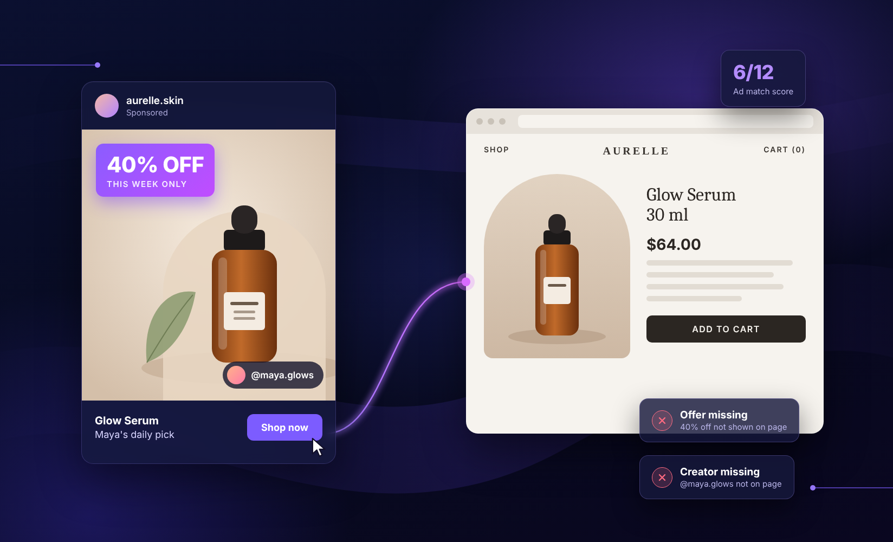

# Find the Facebook ads that are losing sales after the click

  
  
  
  <!-- Downloads counter: delete the two comment markers around the next line once downloads look credible (around 100+). -->
  <!--  -->

**A free Claude skill that checks every active Meta ad against its landing page, flags the mismatches, and tells you which ones to fix first.**

  
  &nbsp;
  <a href="SKILL.md"><picture><source media="(prefers-color-scheme: dark)" srcset="btn-read-dark.png"></picture></a>

Free · One plain-text file · No code · Set up in under 5 minutes

## The problem

Every ad makes a promise, and the landing page has a few seconds to keep it. When it doesn't, shoppers bounce, and you still pay for the click.

It happens more than you'd think:

- The ad says **40% off**, but the page shows full price.
- An **influencer ad** lands on a page with no trace of the influencer.
- The ad features **one product**, but the click lands on a generic collection.
- The ad promises **"ends Sunday"** or free shipping, and the page never mentions it.

With dozens or hundreds of active ads, nobody has time to click through every one. This skill has Claude do it for you.

## What Claude checks

For every active ad and its landing page, Claude scores six things from 0 to 2:

| Area | What it looks for |
| --- | --- |
| Offer | The ad's discount, code or free shipping shows on the first screen |
| Product | The exact product from the ad is featured, including collection pages personalized by the ad's link |
| Creator | The influencer or UGC creator from the ad appears on the page |
| Message | The ad's main claim is repeated in the page headline |
| Look and tone | The page feels like the same brand moment as the ad |
| Details | Urgency, shipping, price, currency and language all match |

Claude opens each page the way a shopper would: on a phone-sized screen, using the ad's exact link.

## What you get

A report ranked by spend, so the most costly problems come first. Here's what part of one looks like, using sample data:

| Ad | Score | What's missing | Weekly spend | Suggested fix |
| --- | --- | --- | --- | --- |
| Summer Sale – Serum | 5/12 | 40% off not shown on page | $4,200 | Add the offer to the top of the page and apply the code from the link |
| @maya.glows – UGC video | 7/12 | Creator not on page | $2,800 | Add a section with her quote and clip |
| Bestsellers carousel | 9/12 | Headline doesn't repeat the hook | $1,100 | Repeat "the serum that sold out 3 times" in the headline |

Each flagged ad also comes with the ad and the landing page shown side by side.

## Set it up in three steps

1. **Download** [`SKILL.md`](https://github.com/rshaw-shogun/ad-landing-page-audit/releases/latest/download/SKILL.md). Keep the file name as it is.
2. **Save it in Claude.** Open a new chat, attach the file and ask: "Save this as a skill." Then click **Save skill**.
3. **Run it.** Ask Claude: "Run the ad–landing page audit." The first time, Claude asks for a few settings, such as who should get the report.

To run it every week, ask Claude: "Create a scheduled task that runs the ad–landing page audit every Monday morning."

## What you'll need connected

- **Your Meta Ads account**, through a Meta Ads connector or a scheduled Ads Manager export
- **Shopify or your analytics tool**, for conversion rates by landing page
- **A browser**, either Claude in Chrome or Claude's built-in browser

## Questions

**Is it safe?**
Yes. It's a single plain-text file of instructions with no code or scripts. You can [read every line](SKILL.md) before downloading. It can only use the tools you've connected to Claude.

**Will it change my ads or my site?**
No. The skill only reports and suggests fixes. It never changes your ads, budgets or pages.

**Do I need to know how to code, or have a GitHub account?**
No. Click the download button, then follow the three steps above.

**Does it cost anything?**
The skill is free. You'll need a Claude account that supports skills and connectors.

## Download

  
  &nbsp;
  <a href="SKILL.md"><picture><source media="(prefers-color-scheme: dark)" srcset="btn-read-dark.png"></picture></a>

New versions are published under [Releases](https://github.com/rshaw-shogun/ad-landing-page-audit/releases). The download button always gets the latest one.

Made by [Shogun](https://getshogun.com). Questions or ideas? Email [ryan@getshogun.com](mailto:ryan@getshogun.com).
